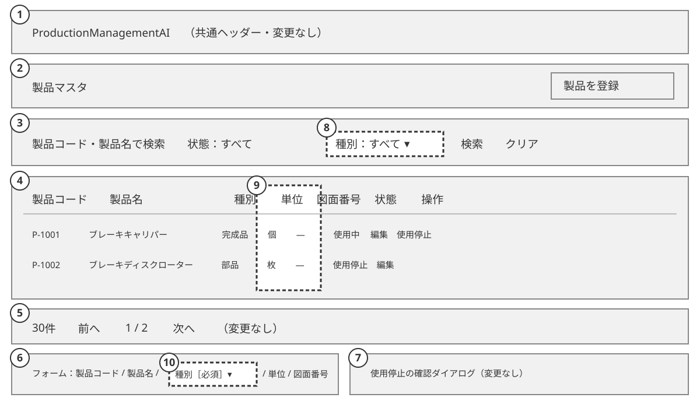
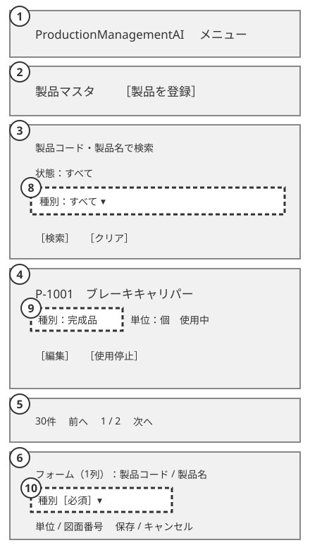

<!-- Based on ai/templates/basic-design.md. Additive to 004_BD (WI-006) and 004_BD-EXISTING-SCREENS, which stay unedited (RFC 0015). -->

# Product Master — Product Type — Basic Design Document (基本設計書)

## Document control (改版履歴)

| Field | Value |
| --- | --- |
| Document ID | 004_BD-TYPE |
| Category | UI + product reference data |
| System name | ProductionManagementAI |
| Subsystem name | Product master |
| Work item | WI-017 |
| Based on brief.md revision | 1 |
| Created by | Claude (for ThanhTN) |
| Created date | 2026-10-25 |
| Last updated by | Claude (for ThanhTN) |
| Last updated date | 2026-10-25 |

| Version | Date | Author | Revision content |
| --- | --- | --- | --- |
| 1 | 2026-10-25 | Claude (for ThanhTN) | Initial creation: required product type 「種別」 on SCR-004 (WI-017 DEC-001–DEC-005) |

This document adds one attribute to products and three places where SCR-004 製品マスタ (Product master) uses it.
Everything it does not mention — search, state filter, paging, rows per page, retirement, unit locking, return
after save, header and navigation — stays exactly as specified in [004_BD](004_BD_製品マスタ.md) and as
implemented by WI-013. Item numbers continue 004_BD's layout numbering (1–7), so new items start at 8.

## System overview

Every product has exactly one type 「種別」 from a fixed list (DEC-001, DEC-004). Admins and Operators choose it when
registering or editing a product, see it on the product list, and can narrow the list by it. Existing products get
a type when the change is installed (DEC-002, DEC-005). Production orders, the dashboard and the order CSV export do
not use the type (DEC-003).

| Requirement ID | Description | Covered by section |
| --- | --- | --- |
| REQ-090 | Required type from a fixed list; existing rows backfilled | §3 Type values; Impact on existing data |
| REQ-091 | Required 「種別」 select on register/edit | §1 item 10; §5; §6 |
| REQ-092 | 「種別」 column (PC) and type on cards (SP) | §1 item 9 |
| REQ-093 | Type filter on the list, kept in the URL | §0-3; §1 item 8; §6 |

## Overall configuration and architecture

No new component, endpoint or screen. The `products` table gains one required column; the existing product-master
API carries the type in its create, update, detail and list payloads and accepts it as an optional list filter. The
browser shows labels; the backend stores and validates codes. Exact column, constraint, migration and API changes are
fixed in 004_DB-TYPE and 004_DD-TYPE.

## Function list

| Function ID | Function name | Description | Related requirement ID |
| --- | --- | --- | --- |
| FN-044 | Classify a product | Store and validate a required type code on create and edit | REQ-090, REQ-091 |
| FN-045 | Filter the catalog by type | Return only products of the given type, combined with the existing search and state filters | REQ-093 |

Changed, not replaced: FN-027 (search and page), FN-028 (create) and FN-029 (edit) from 004_BD carry the type.

## Actors and business flow

Actors: Admin, Operator (unchanged; no new permission).

**Register a product with a type (extends 004_BD create flow)**

1. User presses 「製品を登録」 → the form shows 「種別」 (Type) with 「選択してください」 (Please select) and the 「必須」 marker.
2. User selects e.g. 「部品」 and fills the other fields → 「保存」.
3. System validates the type with the other fields and saves; the list shows the new row with 「部品」.

**Change a product's type**: as above in edit mode. The type stays editable for retired products and for products
referenced by orders, because orders do not depend on it (DEC-003).

**Narrow the list by type**: user picks 「種別」 = 「原材料」 in the filter panel and presses 「検索」 → the list shows only
raw materials, page 1. 「クリア」 resets it to 「すべて」.

## Screen list and screen transition

No new screen, route or transition; see 004_BD. The list URL gains the `type` parameter (§0-3).

## Screen design detail

### SCR-004 Product master — type additions

#### 0-1. Basic information

Unchanged (004_BD 0-1).

#### 0-3. URL parameters

| No | Parameter | Values | Default / invalid |
| --- | --- | --- | --- |
| 1 | `type` (new) | One type code from §3 | Absent = all types. An unknown value is dropped from the URL and treated as all, like other invalid list parameters (WI-013) |

Search, Clear, paging, rows per page and return-after-save keep `type` exactly as they keep the existing parameters;
Clear removes it.

#### 1. Layout and mockup

Layout sketch only; the rendered mockup belongs in 004_DD-TYPE. Dashed boxes are new.

##### PC / desktop

##### SP / mobile

| Item No. | Region / element | Notes |
| --- | --- | --- |
| 1–2, 5, 7 | Header, heading, paging, retire dialog | Unchanged |
| 3 | Search/filter | Unchanged, plus item 8 |
| 8 | 「種別」 filter (new) | Select: 「すべて」 (All) + the four labels in §3 order; placed after 「状態」 (State). Applied only on 「検索」, like the state filter |
| 4 | Catalog | Unchanged, plus item 9 |
| 9 | 「種別」 column / card line (new) | PC: column after 「製品名」 (Name), label text. SP: 「種別：完成品」 on the card line before 「単位：」. Not sortable (the list has no column sorting) |
| 6 | Product form | Unchanged, plus item 10 |
| 10 | 「種別」 select (new) | Required; after 「製品名」, before 「単位」. Create: placeholder 「選択してください」, no preselection. Edit: current value |

#### 2. Content blocks and visible states

No new state. Validation failure, conflict and success states (004_BD §2) include the type field. A no-match result
caused by the type filter uses the existing no-match message.

#### 3. Screen item definition — type values

| Order | Code | Japanese UI text (English gloss) |
| --- | --- | --- |
| 1 | `FINISHED` | 「完成品」 (Finished good) |
| 2 | `SEMI_FINISHED` | 「半製品」 (Semi-finished good) |
| 3 | `PART` | 「部品」 (Part) |
| 4 | `RAW_MATERIAL` | 「原材料」 (Raw material) |

Codes are stored and exchanged; labels are display only. Changing the list later is a schema change (DEC-001).

#### 4. Item value mapping

| Value | Display |
| --- | --- |
| Type code | Label from §3 |
| Filter not set | 「すべて」 (All) |
| Form, no type chosen (create) | 「選択してください」 (Please select) |

#### 5. Validation checks

| Check | User result | Requirement |
| --- | --- | --- |
| Type not chosen | Field error 「種別を選択してください。」 (Please select a type.), in the error summary; save blocked | REQ-091 |
| Unknown type code (API) | 400 validation error on the type field; backend rejects independently of the UI | REQ-090 |
| Unknown `type` list filter (API) | 400 validation error on `type`; the UI never sends one (§0-3) | REQ-093 |

Message IDs are assigned in 004_DD-TYPE.

#### 6. Item events

| Event | Result |
| --- | --- |
| Change 「種別」 filter | No request until 「検索」 (same as 「状態」) |
| 「検索」 / 「クリア」 | Update URL `type` (set / remove) and fetch page 1 |
| Change 「種別」 in form | Marks the form dirty (existing unsaved-change guard) |
| Save | Type sent with the other fields; field error kept on failure |

## Impact on existing screens and data

- **Existing products:** the migration sets every existing product to `FINISHED` (「完成品」) (DEC-005). The demo
  catalog instead gets a realistic type per product, listed in 004_DB-TYPE.
- **SCR-001, SCR-002, SCR-003, order CSV:** no change (DEC-003). `GET /api/products` (order screens' product choices)
  does not gain the type.
- **Tests and fixtures** that create products must send a type.

## Non-functional design

- **Accessibility:** the filter and form selects have visible labels; the required marker is text, not colour only;
  the type error is linked to the field (as other fields, WCAG 2.2 AA).
- **Security:** unchanged roles; server-side allow-list validation of the code on writes and on the filter.
- **Performance:** four values on a small catalog; whether the filter needs an index is decided in 004_DB-TYPE.
- **Observability:** no new telemetry; type values are not sensitive.
