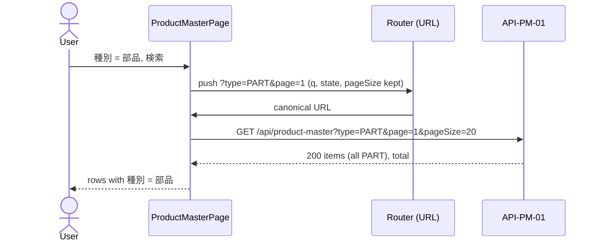
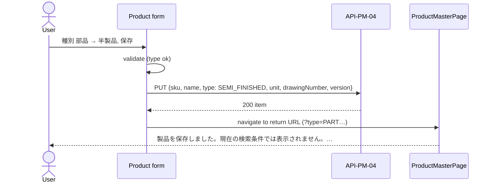

<!-- Additive to 004_DD-SPD (WI-006) as implemented by WI-013; 004_DD-SPD stays unedited (RFC 0015). -->

# Product Master — Product Type — Screen Processing Design (画面処理設計書)

## Document control (改版履歴)

| Field | Value |
| --- | --- |
| Document ID | 004_DD-SPD-TYPE |
| Work item | WI-017 |
| Based on | 004_DD-TYPE v1 (DEC-009), 004_DD-API-TYPE v1 (DEC-010) |
| Created / updated | Claude (for ThanhTN), 2026-10-25 |

| Version | Date | Author | Revision content |
| --- | --- | --- | --- |
| 1 | 2026-10-25 | Claude (for ThanhTN) | Initial creation: `type` in SPD-01 (list) and SPD-02/03 (form) |

Only the steps that change are listed; every other step of [004_DD-SPD](004_DD-SPD_製品マスタ.md) SPD-01–SPD-05, as
implemented by WI-013 (rows per page, return URL, saved-but-hidden notice), runs as before. SPD-04 (retire) and SPD-05
(route, focus, failure mapping) do not change.

## Process catalog

| ID | Component | Change |
| --- | --- | --- |
| SPD-01 | `ProductMasterPage` list | Parse, apply, clear and preserve `type`; render type column/card line |
| SPD-02 | Product form open | Initialise the type select (create empty, edit loaded) |
| SPD-03 | Product form validate/save | Validate and send `type`; map `errors.type`; hidden-after-save check includes `type` |

## SPD-01 — List (changed steps)

| Step | Trigger / branch | Processing and call | Visible / focus result |
| --- | --- | --- | --- |
| 1 | Enter list, Back/Forward | Also parse `type`: keep only a value in `productTypes`; an invalid or repeated `type` is removed in the same `replace` canonicalisation as `state`, before any request | 「種別」 filter shows the applied value or 「すべて」 |
| 2 | Canonical URL changes | API-PM-01 gets `type` only when set (`q`, `state`, `page`, `pageSize` as today) | Unchanged |
| 3 | 200 with items | Render `products.types[item.type]` in the column after 製品名 (PC) and as 「種別：…」 before 単位 on cards (SP). An unknown code from the server (should not happen) renders the raw code, never blank | Unchanged |
| 5 | 検索 | Read the 「種別」 select: `""` removes `type`, else sets it; page → 1; `pageSize` kept | URL updated before fetch |
| 5 | クリア | Also removes `type` and resets the select to 「すべて」 | — |
| 5 | Page / 表示件数 / Edit link return URL | Keep `type` as other applied filters | — |
| 6 | 400 `errors.type` on list | Cannot come from a canonical URL; treat as the existing generic fetch error with Retry | — |

Changing the 「種別」 select alone does not fetch (same as 「状態」).

## SPD-02 — Form open (changed step)

| Step | Trigger | Processing | Result |
| --- | --- | --- | --- |
| 1 | `/products/new` | `draft.type = ''`; initial snapshot the same | Select shows 「選択してください」 |
| 2 | `/products/:id/edit` 200 | `draft.type = item.type` in both draft and initial snapshot | Select shows current label; enabled even when `unitLocked` or retired |
| 3 | Change select | `setField('type', value)`; dirty = draft ≠ initial (existing guard) | Leaving asks the existing discard question |

## SPD-03 — Validate and save (changed steps)

| Step | Trigger / branch | Processing and call | Visible / focus result |
| --- | --- | --- | --- |
| 1 | 保存 | Client validation adds: `draft.type` ∉ `productTypes` → `errors.type = MSG-E026` | Error summary lists it; focus goes to the first invalid field in order sku, name, **type**, unit, drawingNumber |
| 2 | Valid | POST/PUT body includes `type` (code) | Unchanged busy state |
| 3 | 400 with `errors.type` | Map to MSG-E026 at the field, like other server field errors | Draft kept; focus on 「種別」 if it is the first invalid |
| 4 | 200/201 | Existing return to the list URL. The saved-but-hidden check also compares the saved `type` with the return URL's `type` | 「製品を保存しました。」 + hidden hint when the type no longer matches the filter |
| 5 | 409 stale / unit locked | Unchanged; the reloaded item refreshes `type` too | — |

## UI message and test handoff

| Message | Where |
| --- | --- |
| MSG-E026 「種別を選択してください。」 | SPD-03 steps 1 and 3 |

Tests: 004_DD-TYPE "Test viewpoints" plus, from this document — invalid/repeated `type` canonicalised without a
request; select change alone does not fetch; return-after-save keeps `type`; type change away from the filter shows the
hidden hint; edit of a unit-locked product saves a type change.
