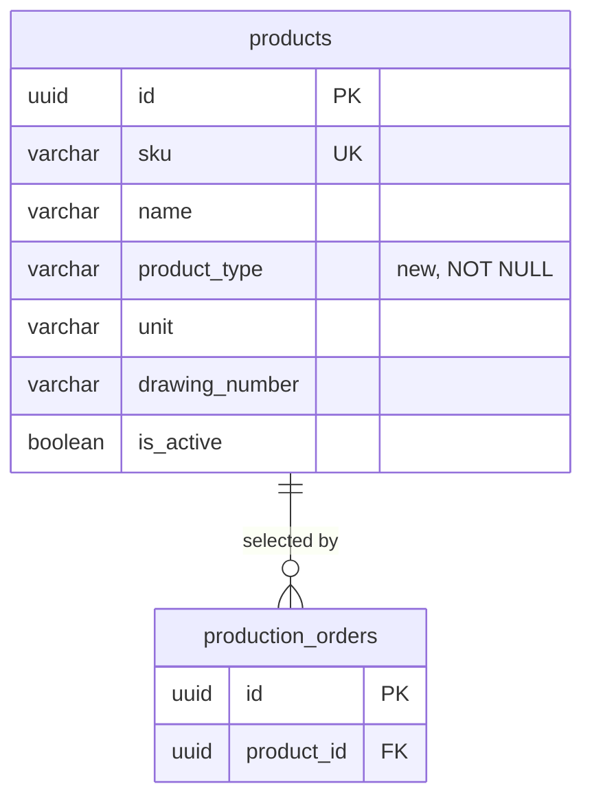

# ProductionManagementAI — Product master — Product Type — Database Design Document (テーブル定義書)

`004_DB-TYPE` defines the database side of [004_BD-TYPE](../../010_basic-design/004/004_BD-TYPE_製品種別_20261025.md)
(WI-017, REQ-090–REQ-093). It is additive: [004_DB](004_DB_製品マスタ.md) and
[004_DB-EXISTING-SCREENS](004_DB-EXISTING-SCREENS_製品マスタ影響.md) stay unedited (RFC 0015), and everything not
mentioned here is as they specify. PostgreSQL 17, `snake_case`, as 004_DB.

## Document control (改版履歴)

| Field | Value |
| --- | --- |
| Document ID | 004_DB-TYPE |
| Work item | WI-017 |
| Database / schema | `production_management_ai` / `public` |
| DBMS / encoding | PostgreSQL 17 / UTF-8 |
| Created / updated | Claude (for ThanhTN), 2026-10-25 |

| Version | Date | Author | Revision content |
| --- | --- | --- | --- |
| 1 | 2026-10-25 | Claude (for ThanhTN) | Initial creation: `products.product_type` (WI-017 DEC-001, DEC-002, DEC-004, DEC-005) |

| No. | Target | Change |
| --- | --- | --- |
| 1 | `products` | Add required `product_type` with an allow-list CHECK |
| 2 | `products` data | Backfill: per-SKU mapping for the 30 demo parts, `FINISHED` for any other row |
| 3 | `pmai_app` privileges | Add `product_type` to the column-scoped `UPDATE` grant |

## Table list (テーブル一覧)

| No. | Schema | Physical name | Logical name | Status |
| --- | --- | --- | --- | --- |
| 1 | `public` | `products` | Product master | Existing; one column added |

No other table changes. `production_orders` and every order read stay as they are (DEC-003).

## ER diagram

## Table definition — `products` (added column only)

| No. | Logical field | Physical name | PostgreSQL type | Nullable | Default | Key / validation | Notes |
| --- | --- | --- | --- | --- | --- | --- | --- |
| 10 | Product type | `product_type` | `varchar(20)` | no | none | `ck_products_product_type` | New. Code from 004_BD-TYPE §3; labels are UI only. Mutable on edit, including retired and order-referenced products |

**Why a code in `varchar` + CHECK, not a PostgreSQL `enum` or a lookup table:** it matches the existing `unit` and
`production_orders.status` columns (CHECK on text), maps to a C# enum stored as string, and a later value change is a
one-line constraint migration. A lookup table was excluded by DEC-001 (fixed list, no master screen).

**No column default after the migration:** every write must name a type, so the API's required-field rule is also
enforced by `NOT NULL` (REQ-090). The default is used only inside the migration's backfill.

## Index definitions (インデックス一覧)

None added. The list filter (FN-045) adds `product_type = @type` to a query over a small, paged catalog (30 demo
rows), and a four-value column has low selectivity; 004_DB's reasoning for not adding search indexes applies.
Reassess with measured growth.

## Trigger definitions

None.

## Constraints

| Constraint | Type | Rule |
| --- | --- | --- |
| `ck_products_product_type` | CHECK | `product_type IN ('FINISHED', 'SEMI_FINISHED', 'PART', 'RAW_MATERIAL')` |
| `product_type NOT NULL` | NOT NULL | Enforced after backfill |

Existing constraints (004_DB) unchanged.

## Initial type mapping for the 30 demo parts (DEC-005)

Applied by SKU (immutable, 004_DB). Assemblies a customer receives are 完成品; machined or formed bodies that are
further processed are 半製品; single components are 部品. None of the demo parts is a raw material, so 「原材料」 has no
demo row; a tester creates one to see it.

| SKU | Part | Type | SKU | Part | Type |
| --- | --- | --- | --- | --- | --- |
| P-1001 | ブレーキキャリパー | FINISHED 完成品 | P-1016 | ボディワイヤーハーネス | FINISHED 完成品 |
| P-1002 | ブレーキディスクローター | PART 部品 | P-1017 | ヘッドランプユニット | FINISHED 完成品 |
| P-1003 | ブレーキパッド | PART 部品 | P-1018 | リレーボックス | PART 部品 |
| P-1004 | ドライブシャフト | FINISHED 完成品 | P-1019 | オルタネーター | FINISHED 完成品 |
| P-1005 | 等速ジョイント | PART 部品 | P-1020 | ECU ケース | SEMI_FINISHED 半製品 |
| P-1006 | トランスミッションケース | SEMI_FINISHED 半製品 | P-1021 | インタークーラー | FINISHED 完成品 |
| P-1007 | ハブベアリング | PART 部品 | P-1022 | 電動ファン | FINISHED 完成品 |
| P-1008 | ウォーターポンプ | FINISHED 完成品 | P-1023 | オイルフィルター | PART 部品 |
| P-1009 | エンジンマウント | PART 部品 | P-1024 | スロットルボディ | FINISHED 完成品 |
| P-1010 | ラジエーター | FINISHED 完成品 | P-1025 | ピストン | SEMI_FINISHED 半製品 |
| P-1011 | タイミングギア | PART 部品 | P-1026 | コネクティングロッド | SEMI_FINISHED 半製品 |
| P-1012 | クラッチディスク | PART 部品 | P-1027 | サブフレーム | FINISHED 完成品 |
| P-1013 | ショックアブソーバー | FINISHED 完成品 | P-1028 | ドアパネル | SEMI_FINISHED 半製品 |
| P-1014 | コイルスプリング | PART 部品 | P-1029 | ドアヒンジ | PART 部品 |
| P-1015 | エンジンワイヤーハーネス | FINISHED 完成品 | P-1030 | ボルト・ナットキット | PART 部品 |

Totals: 13 完成品, 5 半製品, 12 部品, 0 原材料. Any product not in this table (created through SCR-004 or by tests)
gets `FINISHED`.

## Database role and privileges

| Role | Change | Reason |
| --- | --- | --- |
| `pmai_app` | Column-scoped `UPDATE` becomes `(name, product_type, unit, drawing_number, is_active, updated_at_utc)` plus whatever the current grant already lists; `INSERT`/`SELECT` already cover new columns | Edit the type; `sku`, `id`, `created_at_utc` stay non-updatable |
| Migration owner | DDL and backfill | Unchanged |

The exact current grant is read from the migrations during implementation and extended, not replaced.

## API / DD mapping

| Database field | API field | Design use |
| --- | --- | --- |
| `product_type` | `type` (string code) | Product master list items, detail, create and update; optional `type` list filter. Not added to `GET /api/products` or order reads (DEC-003). Exact contract in 004_DD-TYPE |

## Migration impact and recovery

One EF Core migration, run by the owner before the new API is deployed (deploy/README.md):

1. `ALTER TABLE products ADD COLUMN product_type varchar(20) NOT NULL DEFAULT 'FINISHED'` — PostgreSQL 17 adds a
   constant default without rewriting the table, and every existing row reads `FINISHED`.
2. `UPDATE products SET product_type = … WHERE sku IN (…)` for the non-`FINISHED` demo rows in the table above
   (17 rows). Rows already edited by users keep their SKU, so the mapping still applies; absent SKUs are no-ops.
3. `ALTER COLUMN product_type DROP DEFAULT`; add `ck_products_product_type`.
4. Extend the `pmai_app` column `UPDATE` grant.

All four steps run in the migration's transaction, so a failure leaves the table as before. The old API keeps
working between migration and deployment only for reads; its product create would fail `NOT NULL`, so migration and
API deploy go together, as in earlier WIs. `Down` drops the constraint and column (type data is lost; nothing else
depends on it). Verify upgrade from the current `master` database and a fresh database in revision 2.
